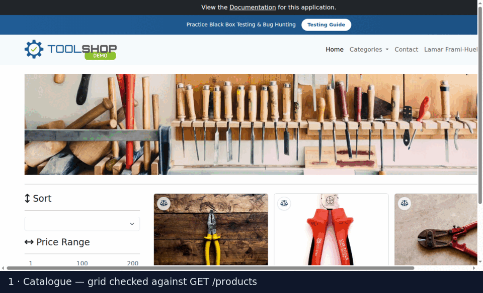

# Toolshop E2E — Cypress Automation Framework

[](https://github.com/mhybiz278/cypress-toolshop-e2e/actions/workflows/e2e.yml)
[](https://mhybiz278.github.io/cypress-toolshop-e2e/)
[](https://mhybiz278.github.io/cypress-toolshop-e2e/)
[](https://www.cypress.io/)
[](LICENSE)

An end-to-end test framework for the open-source [Practice Software Testing "Toolshop"](https://github.com/testsmith-io/practice-software-testing) demo application — an Angular storefront with a documented REST API.

I built this to show how I structure a suite, not just that I can write tests. The application under test is deliberately someone else's: everything here is the part I'd own on a real team — the architecture, the data strategy, the CI, the defect reports, and the reasoning behind each.

**27 specs · 116 tests · Page Object Model + service layer · API-seeded state · accessibility gate · reproducible app stack in CI**



---

## The short version

The suite runs against a real Toolshop instance that `docker compose` brings up from pinned images, so a red build means the tests found something rather than that a public demo was asleep. It runs green — and while making it run green it found **six defects in the application**, including one that loses orders on the primary revenue path.

- 🐛 **[Defect log](docs/DEFECT-LOG.md)** — six findings, with reproduction steps, root-cause analysis and severity rationale
- 📄 **[Latest HTML report](https://mhybiz278.github.io/cypress-toolshop-e2e/)** — published from every run on `main`
- 🧭 **[Test strategy](docs/TEST-STRATEGY.md)** · **[Architecture](docs/ARCHITECTURE.md)**
- 🩻 **[The same suite in Playwright + Python](https://github.com/mhybiz278/playwright-toolshop-e2e)** — the same application tested again in a different stack, with a [written comparison](https://github.com/mhybiz278/playwright-toolshop-e2e/blob/main/docs/CYPRESS-VS-PLAYWRIGHT.md) of how each framework's retry model behaves

## Contents

- [What the suite found](#what-the-suite-found)
- [Running it](#running-it)
- [How it's put together](#how-its-put-together)
- [Design decisions](#design-decisions)
- [What's covered](#whats-covered)
- [Handling known failures](#handling-known-failures)
- [CI](#ci)
- [Known gaps](#known-gaps)

---

## What the suite found

A test suite justifies itself by what it catches. Six defects, all reproducible, all written up in the [defect log](docs/DEFECT-LOG.md):

| ID | Severity | Finding |
|---|---|---|
| [TOOL-2104](docs/DEFECT-LOG.md#tool-2104) | **Critical** | Confirming an order shows "payment success" and **creates no order**. A second click does. |
| [TOOL-2105](docs/DEFECT-LOG.md#tool-2105) | **Critical** (a11y) | The password show/hide button has no accessible name, on every password field in the product |
| [TOOL-2106](docs/DEFECT-LOG.md#tool-2106) | Serious (a11y) | `<ul>` elements with non-`<li>` children break list navigation on the catalogue |
| [TOOL-2101](docs/DEFECT-LOG.md#tool-2101) | Minor | A category slug contains a space, so it is not URL-safe |
| [TOOL-2102](docs/DEFECT-LOG.md#tool-2102) | Minor | A whitespace-only search term is not trimmed, so the shop appears empty |
| [TOOL-2107](docs/DEFECT-LOG.md#tool-2107) | Minor | Three fields on the invoice screen share one `data-test` value |

TOOL-2104 is the one I'd want to talk about in an interview. Every checkout test in the first version of this suite asserted "the success message is visible" — and passed, while no order was created. The message reports the outcome of the *payment check*; order creation is a separate request that the client never sends on the first click, because the handler reads the result of an async call synchronously:

```ts
checkPayment(payload).subscribe(result => {
  if (result === true) { this.invoiceService.createInvoice(...) }   // never runs
})
// checkPayment returns of(this.state) before its own request comes back
```

The fix in the suite was not a better selector. It was separating *what the UI claims* from *what the system did*: `shouldShowPaymentAccepted()` now names exactly what it proves, and one spec — [`checkout/order-creation.cy.js`](cypress/e2e/checkout/order-creation.cy.js) — asserts the order exists over the API. An assertion that cannot fail is worse than no assertion, because it costs the same to run and buys nothing.

---

## Running it

The suite targets a locally running instance so that a CI failure means *the tests found something*, not *the public demo site was down*. The stack is pinned in [`docker-compose.yml`](docker-compose.yml), so a checkout of this repo is all you need.

```bash
npm ci
npm run app:up          # boots the Toolshop stack and seeds the database
npm test                # the whole suite, headless
npm run cy:open         # interactive
```

Useful subsets:

```bash
npm run test:smoke      # @smoke — the pre-merge gate
npm run test:api        # API contract specs only, ~3s, no browser
npm run test:a11y       # accessibility gate
npx cypress run --expose grepTags=@checkout
npm run app:down        # tear the stack down
```

Point it at another environment without touching code:

```bash
CYPRESS_BASE_URL=https://staging.example.com \
CYPRESS_API_URL=https://api.staging.example.com \
npm test
```

There are **no credentials in this repository** and none to configure. Every spec mints its own account over the API, so there is nothing to leak and nothing to keep in sync.

---

## How it's put together

```
cypress/
├── e2e/
│   ├── api/            Contract specs — fast, no browser
│   ├── auth/           Sign in, registration, session, recovery, lockout
│   ├── catalogue/      Listing, search, filters, sorting, pagination, detail
│   ├── cart/           Add, update, totals, empty states
│   ├── checkout/       Registered, guest, payment methods, validation, order creation
│   ├── account/        Profile, favourites, invoices
│   ├── accessibility/  axe on the journeys a customer cannot avoid
│   └── content/        Contact form
└── support/
    ├── pages/          Page Objects — one per screen, plus HeaderComponent
    ├── services/       API layer — ApiClient, Auth, Product, Favourite, Order
    ├── helpers/        dataFactory (Faker), accounts, money parsing
    ├── knownDefects.js Quarantine with an expiry date
    ├── selectors.js    The data-test convention, in one place
    └── commands.js     Five custom commands, no more
```

Four layers, each with one job:

| Layer | Responsibility | Never does |
|---|---|---|
| **Spec** | States intent and asserts business outcomes | Touch a CSS selector |
| **Page Object** | Knows how to drive one screen | Assert business rules |
| **Service** | Sets up and tears down state over HTTP | Know about the DOM |
| **Helper** | Generates data, parses formats | Hold state |

A spec reads as the scenario, not as plumbing:

```js
it('completes an order end to end', () => {
  cartPage.proceedToCheckout();
  checkoutPage.proceedAfterSignIn();
  checkoutPage.fillAddress(newAddress()).proceedToPayment();
  checkoutPage.selectPaymentMethod('bank-transfer');
  checkoutPage.fillBankTransfer(newBankDetails());
  checkoutPage.confirmOrder();

  checkoutPage.shouldShowPaymentAccepted();
});
```

---

## Design decisions

**Set up state through the API, assert through the UI.**
A checkout test is about checkout. Driving the login form first makes it slower and couples it to an unrelated screen — so when auth breaks, twelve specs fail and none of them tell you why. `signedInAsNewCustomer()` seeds the session over HTTP; the auth specs still exercise the real form, because that *is* what they're testing. The invoice specs go further and seed a whole order over the API: they are about the invoice screen, and paying eight seconds a test to arrive there through five wizard steps buys nothing.

**Every spec mints its own account — and this one is not academic.**
The application locks a customer out after three failed sign-ins. A single negative auth test pointed at a shared account leaves it locked, and the cart, checkout and account suites all fail on the next run with `423 Locked` — nowhere near the test that caused it. That is exactly what happened here, and it is why [`auth/login.cy.js`](cypress/e2e/auth/login.cy.js) now asserts the lockout deliberately instead of triggering it by accident.

**Never assert on a value you just changed.**
`cartPage.total()` reads the total once. If a request is still in flight, it reads the old one, and the failure gets filed as flake. Anything that settles asynchronously is asserted through a retrying `should…` method — `shouldHaveTotal()`, `shouldHaveCartQuantity()` — built on `.should()`, which retries. Half the "flaky tests" I have met were this.

**No `cy.wait(ms)`, anywhere.**
The listing renders a state container whose `data-test` value *is* the current state, so `waitForState('search_completed')` waits on a real signal. Paging doesn't stamp that container, so paging waits on the products request instead. Cart writes wait on the cart request. Arbitrary sleeps are banned by lint rule (`cypress/no-unnecessary-waiting`), not by code review.

**Generated data has to match what the application will accept.**
Faker will happily produce "Dr. Anna O'Neill" for a card holder name that the form validates as `[a-zA-Z ]+`, or a US state under a New Zealand address that the API rejects with a cross-field check. The factory generates data that a real customer could actually submit — including letting the app's own postcode lookup fill the city and state, because the API re-runs that lookup and rejects anything that contradicts it.

**Retries are capped at one, deliberately.**
Retries hide flake, they don't fix it. A spec that needs more than one attempt gets investigated, not a higher retry count.

**One place for every selector.**
Test hooks are `data-test` attributes, and the attribute name lives in `selectors.js`. Where the application has *no* usable hook — the cart's delete button, the guest-checkout tab, the invoice screen's three identical `total` hooks — the structural fallback is quarantined inside a single Page Object method and commented, so the brittleness is contained and visible.

**Assertions belong to specs, not Page Objects.**
Page Objects expose `shouldShowPaymentAccepted()` — a visibility check on a known element, named for exactly what it proves. Whether the *order was created* is a business rule, and it's asserted in the spec where a reader can see it.

**API contract specs gate the UI.**
They run in three seconds without a browser. If the products endpoint changed shape, there's no point discovering it as "element not found" three layers up.

**Custom commands are rationed.**
There are five. A command earns its place only if several specs use it and it hides genuine plumbing; anything screen-specific belongs in a Page Object. Otherwise `cy.` becomes a junk drawer.

---

## What's covered

| Area | Specs | Notable cases |
|---|---:|---|
| Authentication | 4 | Valid/invalid sign-in, **user-enumeration parity**, **account lockout after three attempts**, field validation, tampered-token rejection, protected-route redirect |
| Catalogue | 6 | UI-vs-API parity on page 1, search case-insensitivity, filter combination checked against the full filtered set, sort order verified numerically, **no duplicate records across page boundaries** |
| Cart | 4 | Line merging on repeat add, quantity recalculation, zero-quantity rejection, totals to the cent, persistence across reload |
| Checkout | 5 | Registered and guest flows, all 5 payment methods (data-driven), per-method field isolation, expired-card and incomplete-address rejection, **order creation verified over the API** |
| Account | 3 | Profile round-trip, password change verified by signing in again, favourites de-duplication, invoice matched against the API record |
| API contract | 3 | Pagination envelope, product schema, relation integrity, negative-price guard, auth status parity, lockout returns 423 |
| Accessibility | 1 | axe on catalogue, product, cart, sign-in and registration; error messaging exposed to assistive technology |
| Content | 1 | Contact form validation boundaries |

A few of these are the reason I'd write the suite at all:

- **Order creation** (`checkout/order-creation.cy.js`) — found TOOL-2104. The screen says success; the API says no order exists.
- **Account lockout** (`auth/login.cy.js`) — three wrong passwords lock a customer out with `423`. Worth asserting, and worth knowing before it takes a whole suite down.
- **User-enumeration parity** (`auth/login.cy.js`, `api/auth.api.cy.js`) — different error text for "unknown email" versus "wrong password" leaks which addresses hold accounts. The test asserts both paths read identically.
- **Page-boundary duplication** (`catalogue/pagination.cy.js`) — off-by-one errors in offset/limit show up as one record repeated across two pages, never as an obvious failure.
- **UI-vs-API parity** (`catalogue/product-listing.cy.js`) — catches the UI silently dropping or reordering records, which no pure-UI assertion can see.

---

## Handling known failures

Six defects, none of which I can fix, and a build that has to stay meaningful. The three usual answers are all bad: delete the assertion and lose the coverage silently; skip the test, which asserts nothing and tells a reader nothing; or leave the build red, which teaches everyone to ignore red.

What this repo does instead is a **quarantine with an expiry**:

```js
// cypress/e2e/api/reference-data.api.cy.js
const offenders = body
  .filter((category) => !/^[a-z0-9-]+$/.test(category.slug))
  .map((category) => category.slug);

stillPresent('TOOL-2101', offenders, ['storage solutions']);
```

The assertion is pinned to the exact behaviour observed. A *second* bad slug fails the build. So does a fix — with a message telling you to delete the entry and tighten the assertion. The quarantine cannot outlive the defect it documents.

Accessibility uses the same contract in [`cypress/fixtures/a11y-baseline.json`](cypress/fixtures/a11y-baseline.json): axe violations per page as `{ ruleId: nodeCount }`, scoped to WCAG 2.1 A/AA at serious and critical impact. New rules and higher counts fail; lower counts fail too, so the baseline can only shrink.

---

## CI

Both [GitHub Actions](.github/workflows/e2e.yml) and [GitLab CI](.gitlab-ci.yml) are included and equivalent.

```
lint  →  boot the app stack  →  full suite  →  summary + HTML report  →  GitHub Pages
```

Every run writes a Markdown summary to the workflow page, so "what broke?" is answered without downloading an artefact. On `main` the Mochawesome report is published to [GitHub Pages](https://mhybiz278.github.io/cypress-toolshop-e2e/). Screenshots and application logs upload on failure. Nightly full regression at 05:00 NZST, and `workflow_dispatch` takes a tag expression so you can run just `@smoke` or just `@checkout`.

**Why one job rather than a matrix.** The specs are independent by construction, so the suite can be split any way a runner likes. CI doesn't split it, because the application under test is about 6 GB of container images: five matrix legs pull all of it five times over, and each leg spends longer on `docker pull` than the whole suite takes to run. One runner boots the stack once and runs 116 tests in around five minutes. When the suite outgrows that, the split is a one-line matrix — the property that makes it safe is already there.

**Why the app images are pinned, and why Cypress 15.** The catalogue endpoints are fetched with the HTTP `QUERY` method. Cypress 14's proxy rejects it with a 400 before an intercept can even see the request, so every catalogue, cart and checkout spec fails against an empty grid — while the application works perfectly in the same browser outside Cypress. Cypress 15 handles it. Pinning the stack is what makes that kind of incompatibility diagnosable instead of mysterious.

---

## Known gaps

Being straight about what this doesn't do:

- **No visual regression.** Worth adding for the product grid and checkout wizard; it needs a baseline strategy and a way to handle intentional design changes, which is a bigger conversation than a demo repo.
- **Accessibility is a gate, not full coverage.** Serious and critical WCAG 2.1 A/AA rules on five screens. Keyboard-only journeys and screen-reader flow are manual work that axe cannot do.
- **No performance budget.** The listing endpoint would be the place to start.
- **Admin screens untouched.** Scoped out to keep the suite on the customer journey.
- **Mobile viewports untested.** The framework runs at a single desktop viewport; responsive coverage would mean a viewport matrix in CI.
- **The mixed-cart discount is untestable end-to-end.** The API gives 15% off a cart holding both a product and a rental, but every rental in the sample data is out of stock, so that cart cannot be assembled through the UI. Noted rather than covered by a test that would only ever assert an empty cart.

---

## Why this exists

I work daily in a large production Cypress suite as an SDET. That code belongs to my employer, so this is the same thinking rebuilt from scratch on a public application — architecture, data strategy, CI, defect reporting, and the reasoning I'd bring to a code review.

**Mhyli Jade C. Bizares** — QA Engineer & SDET, Auckland NZ
[Portfolio](https://mj-bizares-qa.netlify.app/) · [LinkedIn](https://www.linkedin.com/in/mhyli-jade/)

MIT licensed. The application under test is the property of its authors.
